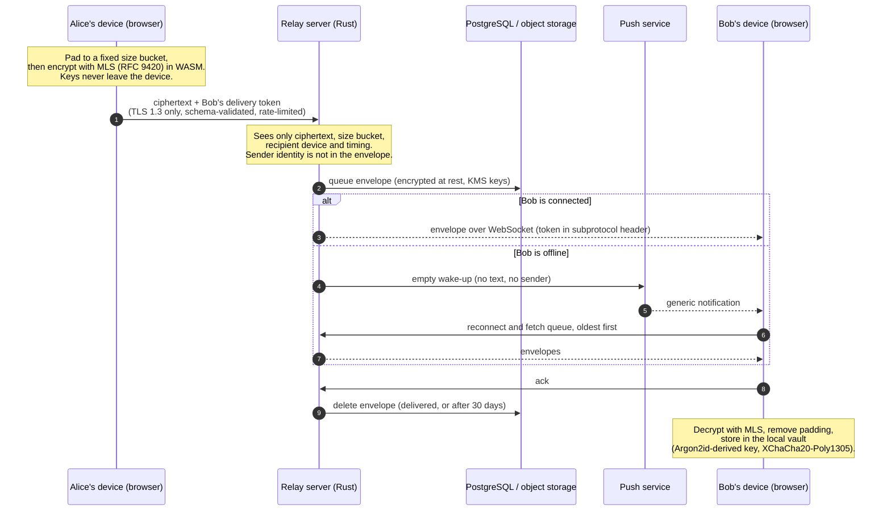
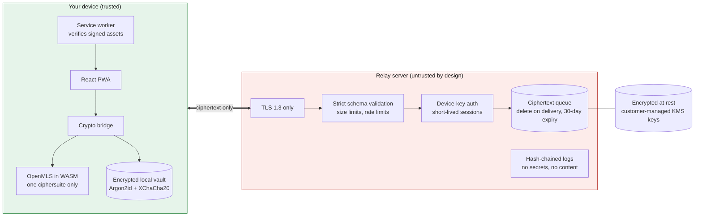

# Secure Chat

A real-time chat where the server can never read your messages. The web app installs on Android and iPhone as a PWA. Security is the product: everything is encrypted in transit and at rest, and the server is treated as an adversary.

> **Status: under construction.** Built with [Spec Kit](https://github.com/github/spec-kit): constitution, then specification, plan, tasks, and implementation in task order. The table below is generated from the task list and checked in `scripts/check.sh`.

## Progress

<!-- progress:start -->
| Phase | Tasks done | Status |
|-------|-----------:|--------|
| Phase 1: Setup (Shared Infrastructure) | 11 / 12 | in progress |
| Phase 2: Foundational (Blocking Prerequisites) | 23 / 32 | in progress |
| Phase 3: User Story 1 - Create an account and start a private 1:1 chat | 0 / 22 | not started |
| Phase 4: User Story 2 - Verify a contact's identity | 0 / 7 | not started |
| Phase 5: User Story 3 - Install on Android and iPhone | 0 / 8 | not started |
| Phase 6: User Story 4 - Link and unlink devices | 0 / 13 | not started |
| Phase 7: User Story 5 - Group conversations | 0 / 11 | not started |
| Phase 8: User Story 6 - Protect data on a device | 0 / 8 | not started |
| Phase 9: User Story 7 - Disappearing messages and deletion | 0 / 6 | not started |
| Phase 10: User Story 8 - Send files, images and voice notes | 0 / 7 | not started |
| Phase 11: User Story 9 - Block, report and control privacy signals | 0 / 7 | not started |
| Phase 12: User Story 10 - Recover an account after losing every device | 0 / 10 | not started |
| Phase 13: Polish and Cross-Cutting Concerns | 0 / 13 | not started |
| **Total** | **34 / 156 (21%)** | |
<!-- progress:end -->

Details: [specs/001-secure-realtime-chat/tasks.md](specs/001-secure-realtime-chat/tasks.md). Tasks that need people (security-lead sign-off, real-device tests, audits) stay open until a person does them.

## What it does (v1)

- Sign up with a username and passcode by invitation. No phone number or email.
- 1:1 chats, groups, files, images and voice notes, disappearing messages.
- Safety Codes to verify a contact. A blocking warning appears if a contact's keys change.
- Several devices per account, linked by QR code and approved on an existing device.
- Recovery Key: regain the account after losing every device, with optional encrypted backup of history.
- Push notifications are empty wake-ups with generic text. No message previews.

Full requirements: [spec.md](specs/001-secure-realtime-chat/spec.md). Vocabulary: [GLOSSARY.md](GLOSSARY.md).

## How a message travels



## Security model at a glance



**What a fully compromised server can learn:** that some device fetched key packages, account IDs and creation dates, device public keys, last-connection time, who receives what and when, and padded message sizes. **It cannot learn:** message or attachment content, group names and membership, contact lists, Safety Codes, or Recovery Keys. See [threat-model.md](specs/001-secure-realtime-chat/threat-model.md) and [data-inventory.md](specs/001-secure-realtime-chat/data-inventory.md).

Key rules (from the [constitution](.specify/memory/constitution.md)): zero-trust server, end-to-end encryption always, no custom cryptography, strict input validation, no secrets in code, supply-chain pinning, and simple code that tests can verify.

## Architecture

| Part | Folder | Technology |
|------|--------|------------|
| Web client (PWA) | `web/` | Vite, React, TypeScript, libsodium |
| Relay server | `server/` | Rust, axum, tokio, sqlx, rustls |
| Crypto module | `crypto-wasm/` | OpenMLS compiled to WASM |
| API contracts | `contracts-schema/` | JSON Schema, shared by server and client |
| Specs and plans | `specs/001-secure-realtime-chat/` | Spec Kit artifacts |
| Decisions | `docs/adr/` | Architecture decision records |

Why a Vite SPA rather than Next.js: [ADR 0003](docs/adr/0003-vite-react-spa-not-nextjs.md). Why MLS for every conversation: [ADR 0002](docs/adr/0002-mls-for-all-conversations.md).

## Run it locally

Needs Rust stable, Node LTS, PostgreSQL 16 binaries (`initdb`, `pg_ctl`, `psql`) and `openssl`.

```sh
scripts/dev.sh        # throwaway database + certificate; server https://localhost:8080, web http://localhost:5173
scripts/check.sh      # everything CI checks: format, lint, tests, dependency policy, README status
scripts/dev-db.sh stop
```

Local state lives in `.local/` (git-ignored). Your browser will warn about the throwaway certificate; that is expected on a dev machine. Only features whose tasks are done work yet. Walkthroughs for each story: [quickstart.md](specs/001-secure-realtime-chat/quickstart.md).

Other checks: `cargo mutants -p <crate>` (mutation testing), `cargo fuzz` in `server/fuzz` and `crypto-wasm/fuzz` (needs nightly Rust). See [docs/testing.md](docs/testing.md).

## Working on it (Spec Kit flow)

1. Read the [constitution](.specify/memory/constitution.md) and [docs/contributing.md](docs/contributing.md).
2. Pick the next unchecked task in [tasks.md](specs/001-secure-realtime-chat/tasks.md); write the tests first.
3. Mark the task `[X]`, then run `scripts/readme-status.sh` to refresh the progress table. `scripts/check.sh` fails if you forget.
4. Spec changes go through `/speckit-specify`, `/speckit-plan` and `/speckit-tasks`, then `/speckit-analyze` before implementing.

## More

[Operations](docs/operations.md) · [Testing](docs/testing.md) · [Accepted risks](docs/accepted-risks.md) · [Storage encryption](server/deploy/storage.md) · [TLS](server/deploy/tls.md)
